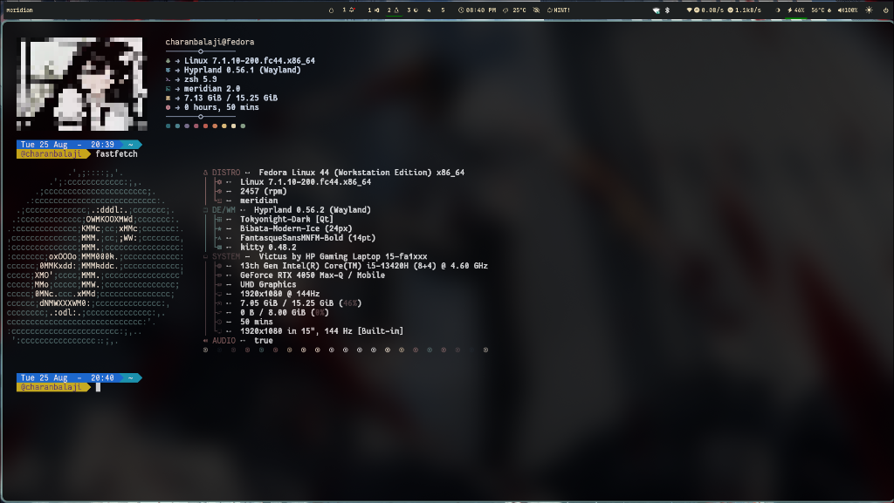

# Zephyr Terminal

[](https://github.com/charanbalaji2005/Meridian-Shell/actions/workflows/ci.yml)
[](LICENSE)

**Zephyr Terminal** is a native Linux terminal emulator written in C++20 and Qt 6. It runs your
shell on a real pseudo-terminal, renders 24-bit color and Unicode, and wraps it in a clean,
modern interface with tabs, split panes, profiles and a command palette. It also ships the
`zephyr` command-line toolkit and the `zephyr-shell` interactive shell.

| Binary | What it is |
|---|---|
| `zephyr-terminal` | The graphical terminal emulator (Qt 6) |
| `zephyr` | Command-line toolkit: local AI helpers, workspaces, system monitor, inline images, … |
| `zephyr-shell` | A standalone interactive shell with job control and autosuggestions |

## Screenshots

> Screenshots of the new `zephyr-terminal` window still need to be captured on a Linux desktop
> (this release was prepared without a display). The image below shows the `zephyr` CLI dashboard.

<p align="center"></p>

## Features

**Terminal**
- Real PTY sessions (`openpty` + `fork` + `execve`, never via `sh -c`), clean hang-up and reaping when a pane closes
- VT/xterm emulation: 16/256/24-bit color, alternate screen, scroll regions, application cursor keys,
  bracketed paste, cursor shape requests (DECSCUSR), cursor-position/device-attribute replies,
  OSC 0/2 titles, OSC 7 working directory, OSC 8 hyperlinks (Ctrl+click), OSC 52, Kitty graphics and Sixel images
- Tabs, plus freely nested side-by-side and top/bottom splits
- Search in output (scrollback + screen), case-sensitive toggle, match highlighting
- Configurable scrollback (0–1,000,000 lines) with a viewport that stays put while output streams
- Copy/paste, X11/Wayland primary selection, middle-click paste, word/line selection
- **Safe paste**: control characters (including ESC) are stripped so a clipboard can't inject escape
  sequences; multi-line pastes can be confirmed when the shell lacks bracketed paste
- Font family, size, line height and ligatures; block/underline/bar cursor, optional blink

**Interface**
- Dark, light or system appearance with a custom accent color; six terminal color schemes
- Background transparency (on compositing desktops) and an optional background image
- Command palette (Ctrl+Shift+P) over every action, profile, SSH host and theme
- Sidebar: profiles & SSH hosts, file browser, shell history (bash/zsh/fish), package manager
  helper, live system information, and an offline command assistant
- Theme-aware Lucide icons, short GPU-cheap animations that respect *reduce motion*

**Configuration**
- Settings window: appearance, colors, terminal, fonts, animations, keybindings, shell profiles,
  SSH connections, startup, Linux integration, NixOS and performance — applied live, saved immediately
- Shell profiles (program, arguments, start folder, environment variables)
- SSH profiles started with OpenSSH, importable from `~/.ssh/config`, validated against option injection
- Session restore: tabs, split layout and folders (never re-runs commands)
- Plain-text config in `~/.config/zephyr/` (`terminal.toml`, `keybindings.toml`, `profiles.toml`, `session.toml`)

Panels never execute anything on their own: history entries, package commands and assistant
suggestions are *typed* at the prompt and run only when you press Enter.

## Installation

Release packages are produced by CI for every tagged version (see
[Releases](https://github.com/charanbalaji2005/Meridian-Shell/releases)). Until a release exists
for your distro, build the package locally with the commands below — each one produces a
native package in `dist/`.

### NixOS / Nix

```bash
nix run github:charanbalaji2005/Meridian-Shell              # try it
nix profile install github:charanbalaji2005/Meridian-Shell  # install for your user
```

NixOS configuration (flake):

```nix
# flake.nix
inputs.zephyr.url = "github:charanbalaji2005/Meridian-Shell";

# in your nixosConfigurations.<host>.modules list:
inputs.zephyr.nixosModules.default
{ programs.zephyr-terminal.enable = true; }
```

See [docs/packaging/nixos.md](docs/packaging/nixos.md) for overlays, `default.nix` and the dev shell.

### Fedora

```bash
sudo dnf install rpm-build rpmdevtools 'dnf-command(builddep)'
sudo dnf builddep packaging/rpm/zephyr-terminal.spec
bash packaging/rpm/build_rpm.sh
sudo dnf install dist/zephyr-terminal-2.6.0-1.*.x86_64.rpm
```

### Debian 12+ / Ubuntu 24.04+

```bash
sudo apt install build-essential devscripts equivs
sudo mk-build-deps -i -r -t 'apt-get -y' packaging/deb/debian/control
bash packaging/deb/build_deb.sh
sudo apt install ./dist/zephyr-terminal_2.6.0-1_*.deb
```

Older releases (Ubuntu 22.04, Debian 11) ship Qt < 6.4 and are not supported by the GUI; use the AppImage.

### Arch Linux

```bash
sudo pacman -S --needed base-devel cmake ninja qt6-base qt6-svg desktop-file-utils appstream
bash packaging/arch/build_pkg.sh
sudo pacman -U dist/zephyr-terminal-2.6.0-1-*.pkg.tar.zst
```

The same `packaging/arch/PKGBUILD` builds from the `v2.6.0` tag for the AUR.

### AppImage (any distro)

```bash
chmod +x Zephyr-Terminal-2.6.0-x86_64.AppImage
./Zephyr-Terminal-2.6.0-x86_64.AppImage
```

Build it yourself on Ubuntu 24.04 / Debian 12 with `bash packaging/appimage/build_appimage.sh`.
To add it to your application menu, open **Settings → Linux Integration → Install launcher for my user**.

### CLI and shell only (no GUI)

The one-line installer builds/installs `zephyr` and `zephyr-shell` (not the GUI):

```bash
curl -fsSL https://raw.githubusercontent.com/charanbalaji2005/Meridian-Shell/main/install.sh | bash
```

## Building from source

Dependencies: a C++20 compiler (GCC 11+ / Clang 14+), CMake ≥ 3.20, Ninja (optional),
Qt ≥ 6.4 with the Widgets and Svg modules. `qt6-wayland` is recommended at runtime.

```bash
cmake -S . -B build -G Ninja -DZEPHYR_BUILD_GUI=ON
cmake --build build
ctest --test-dir build --output-on-failure
./build/zephyr-terminal
sudo cmake --install build          # installs to /usr/local
```

| CMake option | Default | Meaning |
|---|---|---|
| `ZEPHYR_BUILD_GUI` | `AUTO` | `ON` requires Qt 6, `AUTO` builds the GUI when Qt 6 is found, `OFF` skips it |
| `ZEPHYR_BUILD_TESTS` | `ON` | Build `zephyr_tests` and register CTest tests |
| `ZEPHYR_ENABLE_ASAN` | `OFF` | AddressSanitizer + UBSan |
| `ZEPHYR_WARNINGS_AS_ERRORS` | `OFF` | `-Werror` (CI uses it) |

The plain `Makefile` still builds the CLI, shell and tests without Qt (`make all test`);
`make gui` delegates to CMake.

Command-line options of the GUI:

```
zephyr-terminal [--profile NAME] [-d DIR] [--no-restore] [-e PROGRAM [ARGS...]]
```

## Development

```bash
nix develop                        # or install the dependencies above
cmake -S . -B build -G Ninja -DZEPHYR_BUILD_GUI=ON -DCMAKE_BUILD_TYPE=Debug
cmake --build build && ctest --test-dir build --output-on-failure
```

Layout: `src/core` (PTY, VT parser, screen model, input encoding — no Qt), `src/config`
(settings, themes, profiles, sessions — no Qt), `src/gui` (Qt widgets), `src/shell`, `src/ai`,
`src/dev`. Everything outside `src/gui` is toolkit-free and unit-tested. See
[docs/architecture.md](docs/architecture.md) and [docs/packaging.md](docs/packaging.md).

## Troubleshooting

| Problem | Fix |
|---|---|
| `Could not find a package configuration file provided by "Qt6"` | Install `qt6-base-dev qt6-svg-dev` (Debian/Ubuntu), `qt6-qtbase-devel qt6-qtsvg-devel` (Fedora) or `qt6-base qt6-svg` (Arch) |
| `Could NOT find WrapOpenGL` while configuring | Install `libgl-dev` (Debian/Ubuntu) or `mesa-libGL-devel` (Fedora) |
| Window runs under XWayland on a Wayland desktop | Install `qt6-wayland` (or `qt6-qtwayland` on Fedora) |
| Background isn't transparent | Transparency needs a compositor; check *Settings → Appearance → Background opacity* |
| Icons or ligatures look wrong | Pick a font with ligatures (e.g. JetBrains Mono, Fira Code) in *Settings → Fonts* |
| No animations | *Settings → Animations*, and make sure `ZEPHYR_REDUCED_MOTION` isn't set |
| A tab won't close without asking | A program is still running in it; disable the prompt in *Settings → Terminal* |
| Reset everything | Remove `~/.config/zephyr/` (or `$XDG_CONFIG_HOME/zephyr/`) |

---

## Command-line toolkit (`zephyr`)

### 🔑 Connecting to GitHub with Zephyr (`zephyr gh`)

Zephyr features a built-in **1-Click Developer Experience GitHub Integration** that sets up SSH authentication, configures Port 443 fallback (bypassing network restrictions), and links repositories without asking for passwords.

```text
┌─── GitHub Integration Status ────────────────────────────────────────────────┐
│ Account : @charanbalaji2005
│ SSH     : ✓ Connected (Port 443)
│ GitHub  : ✓ Authenticated
│ Key     : ~/.ssh/id_ed25519
│ Remote  : git@github.com:charanbalaji2005/Meridian-Shell.git
└──────────────────────────────────────────────────────────────────────────────┘
```

#### 1️⃣ Connect Your GitHub Account (1-Click)
```bash
zephyr gh connect
```
- Automatically detects or generates an ED25519 SSH key (`~/.ssh/id_ed25519` or `~/.ssh/zephyr_github_ed25519`) **without overwriting existing keys**.
- Configures `~/.ssh/config` to use **Port 443** so it works on all Wi-Fi and corporate networks.
- Tests the live connection and verifies write access.

#### 2️⃣ Check Connection Status
```bash
zephyr gh status
```

#### 3️⃣ View Public SSH Key
```bash
zephyr gh key
```

#### 4️⃣ Create & Link a New Repository
```bash
zephyr gh repo create my-project
```

#### 5️⃣ Smart, Non-Blocking Git Hints
When you run `git init` in a new folder, Zephyr displays non-blocking next steps to connect and push your project. You can toggle hints on/off anytime:
```bash
zephyr gh hints on    # Enable hints
zephyr gh hints off   # Disable hints
```

---

### 💻 VS Code Integration (`zephyr vscode`)

Auto-detects your VS Code installation and configures Zephyr Shell as a ready-to-use integrated terminal profile:

```bash
# Check current VS Code terminal status
zephyr vscode status

# Set Zephyr as default VS Code terminal
zephyr vscode enable

# Reset back to standard bash/zsh
zephyr vscode disable
```

---

### 🔄 Updating Zephyr (`zephyr update`)

Zephyr includes a native update engine that checks GitHub Releases, verifies SHA256 checksums, and updates your installation:

```bash
# Check if an update is available
zephyr update --check

# Download, verify, and apply the latest update
zephyr update
```

---

### 📊 Anonymous Usage Statistics & Telemetry (`zephyr stats`)

```bash
# View global usage overview
zephyr stats

# View breakdown for a specific year
zephyr stats --year 2026

# View yearly adoption growth rates
zephyr stats --growth
```

#### 🛡️ Privacy-First Telemetry
Zephyr's telemetry is **strictly opt-in (disabled by default)** and collects zero personal data, commands, or file paths:

```bash
zephyr telemetry status    # View privacy policy & current state
zephyr telemetry enable    # Opt-in to anonymous metrics
zephyr telemetry disable   # Opt-out completely (Zero network metrics)
```

---

### 🎨 Interactive Anime Artwork Themes

Choose from 14 embedded anime themes or render full-color raster images:

```bash
# Select startup anime wallpaper (0-13)
pic set 0       # Sharingan Eye
pic set 2       # Sakura Girl
pic set 4       # Cyberpunk Edgerunners
pic set 6       # Gojo Satoru
pic set random  # Random wallpaper on every launch

# Render any image inline inside terminal
pic /path/to/image.png
```

---

### 🛠️ Master Command Reference

| Subcommand | Description |
| :--- | :--- |
| `zephyr` | Launch interactive GPU-accelerated Zephyr Terminal |
| `zephyr-shell` | Launch standalone C++20 POSIX shell |
| `zephyr gh connect` | 1-Click GitHub SSH key setup & live authentication |
| `zephyr gh status` | Inspect GitHub connection and remote repository |
| `zephyr gh key` | View public SSH key |
| `zephyr vscode enable` | Set Zephyr as VS Code default integrated terminal |
| `zephyr update` | Update to the latest release with SHA256 verification |
| `zephyr stats` | Display anonymous platform metrics and yearly growth |
| `zephyr telemetry status` | View opt-in telemetry configuration and privacy policy |
| `monitor` | Live CPU, RAM, Disk, Network metrics dashboard |
| `gitintel` | Visual Git branch divergence and staged/unstaged changes |
| `files [dir]` | Tree file explorer with Git badges |
| `ssh-mgr [alias]` | Native SSH workspace manager (`~/.ssh/config`) |
| `ask "<intent>"` | Translate natural language to safe shell commands |
| `diag "<error>"` | Offline compiler, runtime, and database error diagnostics |
| `palette [query]` | Command Palette with fuzzy search (`Ctrl+Shift+P`) |
| `search "<query>"` | Universal search across screen buffers and history (`Ctrl+Shift+F`) |
| `split [v\|h]` | Binary tree pane split (`Ctrl+Shift+D` / `Ctrl+Shift+E`) |
| `pic <file>` | Direct 32-bit RGBA hardware raster image viewer |
| `perf` | Live GPU framerate, PTY latency & telemetry profiler |

---

## Contributing

```bash
git clone https://github.com/charanbalaji2005/Meridian-Shell.git
cd Meridian-Shell
cmake -S . -B build -G Ninja -DZEPHYR_BUILD_GUI=ON
cmake --build build && ctest --test-dir build --output-on-failure
```

Issues and pull requests are welcome. See [CONTRIBUTING.md](CONTRIBUTING.md).

## License

GPL-3.0-or-later — see [LICENSE](LICENSE). UI icons use Lucide geometry (ISC,
`resources/icons/ui/LICENSE`); `stb_image.h` is public domain / MIT.
